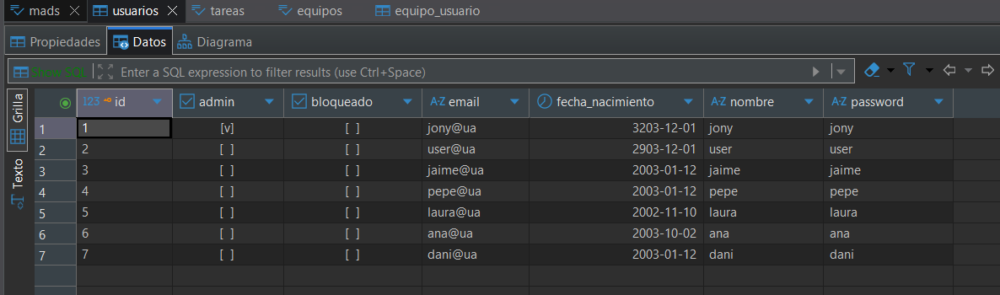
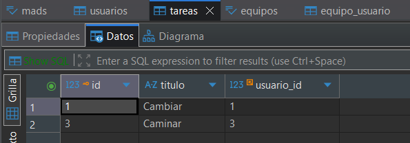
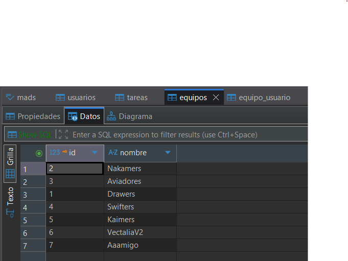
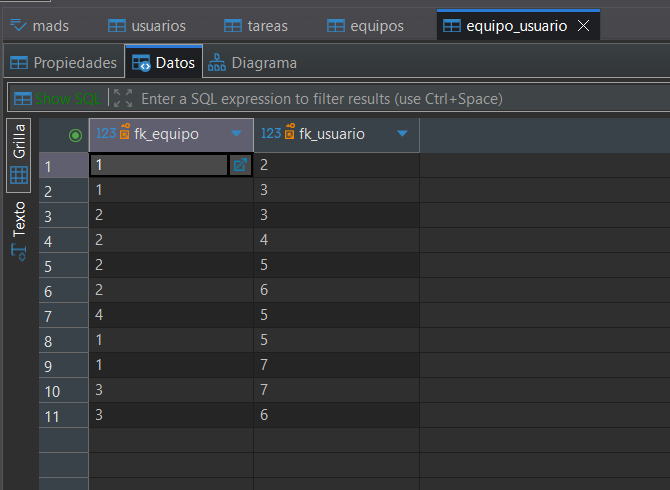

# Documentación Técnica - Evolución ToDoList (Versión 1.2.0)

## 1. Introducción y Arquitectura General

Esta práctica cubre las HU009 (gestionar pertenencia al equipo) y HU010 (gestión de equipos), apoyadas en el listado de la HU008. El trabajo se organizó en PRs: `#25`/`#30` modelo y servicio de equipos, `#31` servicio de pertenencia, `#32` vista y controller de pertenencia, `#33` servicio de edición y borrado, `#34` vista y controller de gestión y `#35` correcciones (usuarios duplicados y permisos de administrador). La versión en `pom.xml` pasó a `1.2.0`.

## 2. Pantalla de la Base de Datos PostgreSQL

La base de datos de desarrollo PostgreSQL `mads` (perfil `postgres`) contiene cuatro tablas generadas por Hibernate: `usuarios`, `tareas`, `equipos` e intermedia `equipo_usuario`. Estado final:









La relación N:N se modela con `@ManyToMany` en la entidad `Equipo`, que genera `equipo_usuario` con las claves foráneas `fk_equipo` y `fk_usuario`. No hay entidad Java `EquipoUsuario`; la persistencia la gestiona Hibernate.

## 3. Listado de Nuevas Clases, Métodos y DTOs

### 3.1. Capa de Modelo y Repositorio

- `Equipo`: nuevo campo `usuarios` (`Set<Usuario>`) con `@ManyToMany(fetch = FetchType.LAZY)` y `@JoinTable(name = "equipo_usuario", ...)`, más los métodos `addUsuario(usuario)` y `removeUsuario(usuario)`, que mantienen sincronizadas ambas caras de la relación.
- `Usuario`: nueva relación inversa `equipos` (`@ManyToMany(mappedBy = "usuarios")`).

### 3.2. Capa de Servicios

`EquipoService` implementa la lógica de negocio de las dos historias, lanzando `EquipoServiceException` ante cualquier violación:

- HU009: `añadirUsuarioAEquipo` (rechaza equipo/usuario inexistente o ya presente), `eliminarUsuarioDeEquipo`, `usuariosEquipo` (miembros ordenados alfabéticamente) y `equiposUsuario`.
- HU010: `crearEquipo` y `editarNombreEquipo` (rechazan nombres nulos o vacíos), `eliminarEquipo`, `recuperarEquipo` y `findAllOrdenadoPorNombre`. El borrado limpia `equipo_usuario` automáticamente.

### 3.3. Capa de Controladores (Controllers)

`EquipoController` (nuevo) define los endpoints de ambas historias; todos exigen sesión con `ManagerUserSession` y los de edición/borrado además `usuario.isAdmin()`, lanzando `UsuarioNoLogeadoException` (401 vía `@ControllerAdvice`):

| Método | Ruta | Acción (HU) |
| --- | --- | --- |
| GET | `/equipos/{id}` | Detalle/miembros (009) |
| POST | `/equipos/{id}/usuarios` | Añadir por email (009) |
| POST | `/equipos/{idEquipo}/usuarios/{idUsuario}/eliminar` | Quitar miembro (009) |
| GET/POST | `/equipos/nuevo` | Crear equipo (010) |
| GET/POST | `/equipos/{id}/editar` | Editar nombre, sólo admin (010) |
| DELETE | `/equipos/{id}` | Borrar vía `fetch`, sólo admin (010) |

### 3.4. Objetos de Transferencia de Datos (DTOs)

- `EquipoData`: `{id, nombre}`, mapeado con ModelMapper.

## 4. Plantillas Thymeleaf y Fragmentos UI

- `detalleEquipo.html` (HU009): tabla de miembros (id, nombre, email) con un formulario por fila para `POST .../usuarios/{idUsuario}/eliminar`, y un formulario "Añadir participante" con email obligatorio. Muestra "El equipo no tiene miembros" si está vacía y mensajes *flash* de éxito o error.
- `listaEquipos.html`: la columna "Acciones" (Editar/Borrar) sólo se renderiza con `th:if="${esAdmin}"`; el botón "Borrar" lanza `del()`, que hace `confirm()` y una petición `fetch` con método `DELETE`.
- `formNuevoEquipo.html` y `formEditarEquipo.html` (HU010): formularios que envían el nombre por `POST`; el de edición muestra el nombre actual y redirige si el equipo no existe.
- `fragments.html`: el enlace "Equipos" de la navbar está disponible para cualquier usuario logueado.

## 5. Ejemplos de Código Fuente Relevante

### 5.1. Control de duplicados al añadir un miembro (HU009)

Antes de modificar el `Set` de usuarios, el servicio valida la pertenencia para no insertar filas duplicadas en `equipo_usuario`:

```java
@Transactional
public void añadirUsuarioAEquipo(Long idEquipo, Long idUsuario) {
    Equipo equipo = equipoRepository.findById(idEquipo)
            .orElseThrow(() -> new EquipoServiceException("No existe el equipo con id " + idEquipo));
    Usuario usuario = usuarioRepository.findById(idUsuario)
            .orElseThrow(() -> new EquipoServiceException("No existe el usuario con id " + idUsuario));
    if (equipo.getUsuarios().contains(usuario)) {
        throw new EquipoServiceException("Usuario ya en el equipo");
    }
    equipo.addUsuario(usuario);
}
```

La excepción se recoge en el controlador y se devuelve como mensaje *flash* en el detalle.

### 5.2. Borrado de equipo sólo para administradores (HU010)

`@ResponseBody` devuelve la respuesta como cuerpo para que el JavaScript de la vista recargue la página:

```java
@DeleteMapping("/equipos/{id}")
@ResponseBody
public String eliminarEquipo(@PathVariable(value = "id") Long equipoId, RedirectAttributes flash) {
    Long idUsuarioLogeado = managerUserSession.usuarioLogeado();
    if (idUsuarioLogeado == null) throw new UsuarioNoLogeadoException();
    UsuarioData usuario = usuarioService.findById(idUsuarioLogeado);
    if (usuario == null || !usuario.isAdmin()) throw new UsuarioNoLogeadoException();
    try {
        equipoService.eliminarEquipo(equipoId);
        return "";
    } catch (EquipoServiceException e) {
        return "ERROR: " + e.getMessage();
    }
}
```

El mismo `isAdmin()` protege editar; crear equipos y gestionar miembros sólo requiere sesión.

### 5.3. Consumo del `DELETE` desde la plantilla

```javascript
function del(urlBorrar) {
    if (confirm('¿Estás seguro/a de que quieres borrar el equipo?')) {
        fetch(urlBorrar, { method: 'DELETE' }).then((res) => location.reload());
    }
}
```

## 6. Estrategia de Pruebas Automáticas (Tests)

### 6.1. Tests de Servicio

`EquipoServiceTest` (`@SpringBootTest` sobre H2, `@Sql("/clean-db.sql")`, GIVEN/WHEN/THEN) cubre HU009 con `añadirUsuarioAEquipo`, `eliminarUsuarioDeEquipo` y `comprobarExcepciones`, y HU010 con `editarNombreEquipo` y `eliminarEquipo` (verifica que el usuario queda sin equipos).

### 6.2. Tests de Controladores (Capa Web)

`EquipoWebTest` (22 tests con `MockMvc`, `@MockBean ManagerUserSession` y `@Sql("/clean-db.sql")`) destaca: `postAddUsuarioAEquipoLoAnadeYSeRenderiza`, `postAddUsuarioAEquipoSinLoginDevuelveNoAutorizado` (401), `postEditarNombreEquipoConUsuarioNoAdminDevuelveNoAutorizado`, `deleteEquipoLoElimina`, `deleteEquipoUsuarioNoAdminDevuelveNoAutorizado` (el equipo sigue existiendo), `getEquiposOcultaAccionesAUsuariosNoAdmin` y `getEquiposMuestraAccionesAAdmin`.
